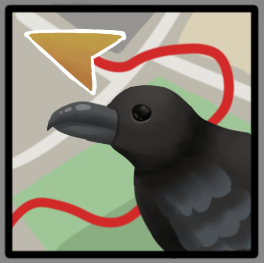

# Korvus a KDE client for Hauk location sharing

[Hauk](https://github.com/bilde2910/Hauk) provides private self-hosted location sharing.
Korvus allows you to share your location, and displays you and your friends on a map.
Additionally, Korvus allows you to follow other sharing sessions.

## Features

- **Solo shares**: share your own location for a set time.
- **Group shares**: start a group, or join an existing one with its 6-digit PIN.
- **Follow others**: enter a Share ID to see another user's or group's live location on the map.
- **Map view**: see yourself and everyone you follow, including their names in group shares.

## Requirements

- A Hauk server, either your own [self-hosted instance](https://github.com/bilde2910/Hauk#installation) or a public one
- Qt 6.11 or newer with these modules:
  - Core, Quick, QuickControls2, QuickWidgets
  - Positioning, Location
  - OpenApiCommon (plus OpenApiTools if you want to regenerate the API client)
- CMake 4.0 or newer
- A C++20 compiler
